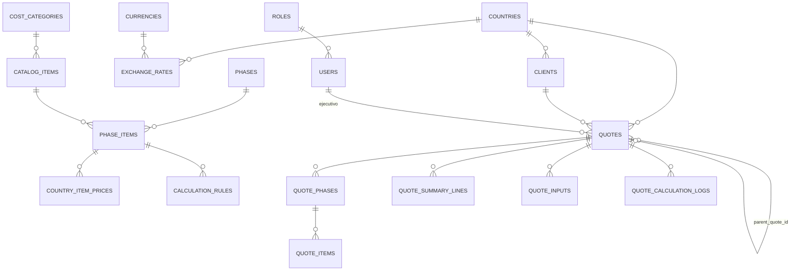

# Arquitectura del Sistema de Cotizaciones

## 1. Visión general

Monorepo con dos aplicaciones independientes que comparten contrato de API:

```
costosapp/
├── backend/    Node.js + TypeScript + Express + Sequelize + MySQL
├── frontend/   React + TypeScript + Vite
├── Modelo Cotizador Excel.xlsx
└── ARQUITECTURA.md
```

El sistema parte de un modelo de costeo que vivía en Excel (`Modelo Cotizador Excel.xlsx`). Sus fórmulas se
trasladaron a una arquitectura web modular y escalable, con el cálculo centralizado en el backend.

## 2. Arquitectura del backend

```
backend/src/
├── config/         Configuración (env, sequelize, cors, jwt)
├── database/       Conexión, migraciones y seeders
├── models/         Modelos Sequelize (una clase por tabla)
├── repositories/   Acceso a datos (queries complejas reutilizables sobre los modelos)
├── services/       Lógica de negocio (auth, quotes, maintenance, reports)
├── engine/         Motor de cálculo de cotizaciones (reglas del Excel)
├── controllers/    Controladores HTTP (reciben request, llaman a services, responden)
├── routes/         Definición de rutas REST
├── middlewares/    auth (JWT), roles (RBAC), validación, manejo de errores
├── validations/    Esquemas de validación (zod) por endpoint
├── types/          Interfaces y tipos compartidos
├── utils/          Utilidades (hash, jwt, números, fechas)
└── app.ts / server.ts
```

Capas: `routes -> middlewares -> controllers -> services -> (engine | repositories) -> models -> MySQL`.
Los controladores no contienen lógica de negocio; los services no conocen HTTP; el motor de cálculo es puro
(no depende de Express ni de la base de datos) para poder probarse de forma aislada.

## 3. Arquitectura del frontend

```
frontend/src/
├── api/            Cliente HTTP (axios) + funciones por recurso
├── auth/            Contexto de autenticación, rutas protegidas por rol
├── components/      Componentes reutilizables (tabla genérica CRUD, inputs, layout)
├── features/
│   ├── quotes/       Listado, formulario/constructor de cotización, resumen
│   ├── maintenance/  Países, monedas, tasas, clientes, fases, categorías, conceptos, precios, reglas, usuarios
│   ├── dashboard/
│   └── reports/
├── pages/            Composición de rutas
├── types/
└── utils/            Formateo de moneda, fechas, números
```

## 4. Modelo de datos (MySQL)

### Seguridad y usuarios
- `roles(id, name)` — solo `ADMINISTRADOR` y `EJECUTIVO`.
- `users(id, name, email, password_hash, role_id, active, created_at, updated_at)`.

### Geografía y monedas
- `countries(id, name, iso2, iso3, currency_id, is_default, active)`.
- `currencies(id, code, name, symbol)` — siempre existe `USD` como moneda base.
- `exchange_rates(id, country_id, base_currency_id, target_currency_id, rate, valid_from, valid_to, active, created_by)`
  — historial completo; nunca se edita una tasa pasada, se cierra (`valid_to`) y se crea una nueva.

### Clientes
- `clients(id, country_id, name, legal_name, tax_id, contact_name, email, phone, address, active, created_at, updated_at)`.

### Mantenimientos de costeo (configurables, sin valores en código)
- `phases(id, name, code, sort_order, active)`.
- `cost_categories(id, name, code, active)` — Personal local, Personal corporativo, Viáticos, Materiales,
  Servicios, Incentivos.
- `catalog_items(id, category_id, name, code, unit_label, active)` — el catálogo de conceptos (roles,
  viáticos, materiales, etc.).
- `phase_items(id, phase_id, catalog_item_id, active)` — asociación N:M configurable de qué conceptos aplican
  a cada fase.
- `country_item_prices(id, country_id, phase_item_id, unit_price_usd, valid_from, valid_to, active, created_by)`
  — precios versionados por país + concepto de fase (permite históricos, igual que `exchange_rates`).
- `calculation_rules(id, code, name, rule_type, params_json, phase_item_id NULL, active)` — reglas
  reutilizables (`CEIL_RATIO`, `PERCENT_OF_DAYS`, `UNIT_COST_DELTA`, `REFERENCE_SALARY`, etc.) con parámetros
  en JSON, aplicables globalmente o a un `phase_item` específico.
- `sizing_parameters(id, quote_id NULL, phase_code, sample_size, base_effectiveness, attempts, minutes_between_attempts,
  survey_minutes, work_hours_day, team_size, error_margin, days_per_week)` — parámetros del motor de
  dimensionamiento de muestra (bloque Piloto/Levantamiento del Excel); cuando `quote_id` es `NULL` son valores
  por defecto de mantenimiento, cuando tiene valor son los usados en una cotización concreta.

### Cotizaciones (inmutables una vez creadas)
- `quotes(id, quote_number, version, parent_quote_id, client_id, country_id, currency_id, exchange_rate_used,
  executive_id, title, description, sample_size, margin_percent, status, valid_until, created_at, updated_at)`.
  Estados: `BORRADOR, EN_REVISION, APROBADA, RECHAZADA, CANCELADA`.
- `quote_inputs(id, quote_id, key, value)` — parámetros generales capturados (efectividad, intentos, tiempos,
  ratios, salario base, etc.) como copia inmutable de lo usado.
- `quote_phases(id, quote_id, phase_id, phase_name_snapshot, sort_order, subtotal_usd, subtotal_local)`.
- `quote_items(id, quote_phase_id, catalog_item_id, item_name_snapshot, category_snapshot, quantity, days,
  unit_price_usd_snapshot, total_usd, total_local, internal_cost_usd_snapshot, rule_snapshot_json)`
  — snapshot completo de nombre, precio, fórmula/regla y resultado calculado.
- `quote_summary_lines(id, quote_id, label, value_usd, value_local, kind)` — filas del resumen final
  (total operación, incentivos, total, costo interno, margen esperado, costo por muestra, costo por día-persona).
- `quote_calculation_logs(id, quote_id, executed_at, input_snapshot_json, output_snapshot_json)` — trazabilidad
  de cada recálculo (auditoría).

### Relaciones clave



**Regla de inmutabilidad**: al crear/recalcular una cotización, el motor lee los mantenimientos vigentes
(precios, tasas, reglas) y escribe una copia (`*_snapshot`) dentro de `quote_items`/`quote_inputs`. Cambios
posteriores en mantenimientos SOLO afectan a cotizaciones nuevas o recalculadas explícitamente en estado
`BORRADOR`.

## 5. Flujo de una cotización

1. El ejecutivo crea una cotización: selecciona cliente, país (Honduras por defecto), moneda local
   (heredada del país) y parámetros generales (tamaño de muestra, efectividad, etc.).
2. El sistema resuelve la tasa de cambio activa del país y la copia a `quotes.exchange_rate_used`.
3. Para cada fase activa asociada a conceptos (`phase_items`), el motor de cálculo:
   - Resuelve cantidades base (input del usuario) y cantidades derivadas (reglas `CEIL_RATIO`, herencias).
   - Resuelve días base y días derivados (reglas `PERCENT_OF_DAYS`, herencias).
   - Resuelve el precio vigente (`country_item_prices`) y aplica reglas `UNIT_COST_DELTA` si corresponden.
   - Calcula `total = cantidad * dias * costo_unitario` (regla `LINE_TOTAL`).
   - Calcula el costo interno normalizado (`REFERENCE_SALARY` / `INTERNAL_COST_NORMALIZED`) para margen.
   - Convierte a moneda local con la tasa copiada.
4. Se agregan subtotales por fase (`quote_phases.subtotal_*`).
5. Se calcula el resumen final: total operación, incentivos, total general, costo interno total, margen
   esperado (valor y %), costo por muestra y por día-persona (`quote_summary_lines`).
6. El ejecutivo guarda como `BORRADOR`, puede recalcular mientras esté en `BORRADOR`/`EN_REVISION`, duplicar
   (nueva cotización con `parent_quote_id`) o crear una nueva versión (`version += 1`, mismo `quote_number`).
7. Un cambio de estado a `APROBADA`/`RECHAZADA`/`CANCELADA` congela la cotización (ya no editable).

## 6. Motor de cálculo

Módulo puro en `backend/src/engine`, sin dependencias de Express/Sequelize:

- `rules/` — una función por tipo de regla (`lineTotal`, `ceilRatio`, `percentOfDays`, `unitCostDelta`,
  `referenceSalary`, `sampleSizing`, `proportionalDataCost`, `expectedMargin`, etc.), todas puras y testeables.
- `RuleEngine` — recibe `calculation_rules` (config) + inputs de la cotización y ejecuta la regla indicada
  por `rule_type`, devolviendo el valor calculado y un `rule_snapshot` para auditoría.
- `QuoteCalculator` — orquesta el cálculo completo de una cotización (fases → items → subtotales → resumen)
  usando el `RuleEngine` y los repositorios de mantenimiento (a través de un puerto/interfaz, para poder
  testear con datos en memoria).

Así se evita **repetir fórmulas en la interfaz**: toda la lógica vive en un solo lugar
y tanto la creación como el recálculo de cotizaciones pasan por el mismo motor.

## 7. Seguridad y permisos

- Autenticación: JWT firmado con secreto en `.env`, expiración configurable, refresh simple.
- Contraseñas: `bcrypt` (nunca texto plano).
- Middleware `requireAuth` valida el token; middleware `requireRole(['ADMINISTRADOR'])` protege mantenimientos.
- Middleware `requireQuoteOwnership` valida que un `EJECUTIVO` solo pueda ver/editar sus propias cotizaciones
  (comparando `quotes.executive_id` con el usuario autenticado); `ADMINISTRADOR` tiene acceso total.
- Validación de entrada con `zod` tanto en backend (obligatoria) como en frontend (UX).
- CORS restringido a los orígenes configurados por `.env`.
- Variables sensibles (credenciales de MySQL, `JWT_SECRET`) solo en `.env` (no versionado, se entrega `.env.example`).
- Soft delete: la mayoría de mantenimientos usan `active` en lugar de borrado físico; las cotizaciones nunca
  se eliminan físicamente si tienen historial (se cancelan).

## 8. Etapas de implementación

1. Análisis del modelo de costeo en Excel.
2. Diseño de la arquitectura (este documento).
3. Migraciones y seeders MySQL.
4. Autenticación (JWT + bcrypt).
5. Usuarios y roles.
6. Países, monedas, tasas de cambio.
7. Mantenimientos (clientes, fases, categorías, conceptos, precios, reglas).
8. Motor de cálculo basado en las reglas reales del Excel.
9. Cotizaciones (crear/editar/duplicar/versionar).
10. Resumen, subtotales, totales y conversión de moneda.
11. Frontend (login, dashboard, mantenimientos, constructor de cotizaciones).
12. Pruebas del motor de cálculo y de los flujos principales.

---

Diseñado y desarrollado por **Ariel Geovanny Andino Chinchilla** · [GitHub](https://github.com/andino1234)
